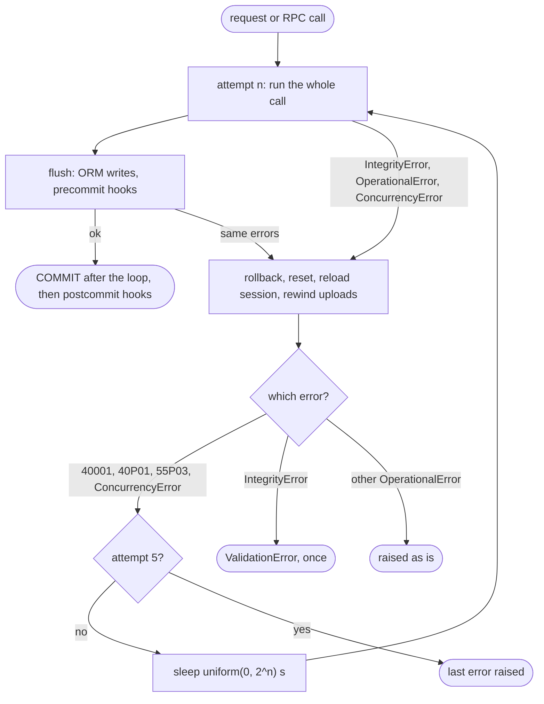

# 02 - Attempts vs retries

> **Scope:** Odoo 19.0 EE, `odoo/odoo@e6ebad8`.
> **Status:** verified in the source, by `tests/test_retrying_facts.py`, by the demo (*Exhaust retries*), and by experiment for the entry-point counts (17.0 probe, 19.0 demo over XML-RPC).

## TL;DR

- `MAX_TRIES_ON_CONCURRENCY_FAILURE = 5` counts **attempts**: `for tryno in range(1, 6)`, so one run plus at most four retries.
- Plan every side effect for **5 executions per call**. Twice is the common case; five is the worst case of one loop.
- Loops can nest: on 17.0 an XML-RPC call ran **25 times** (measured). 18.0+ closes the request cursor first and stays at 5.
- After the fifth failure the last error reaches the caller unchanged; the log says `maximum number of tries reached!`.

<!-- slide -->



## Deep dive

### `retrying()` line by line

```python
def retrying(func, env):                                            # model.py:160
    try:
        for tryno in range(1, MAX_TRIES_ON_CONCURRENCY_FAILURE + 1):  # 1, 2, 3, 4, 5
            tryleft = MAX_TRIES_ON_CONCURRENCY_FAILURE - tryno       # 4, 3, 2, 1, 0
            try:
                result = func()                                     # the whole call, from authentication to response
                if not env.cr._closed:
                    env.cr.flush()                                  # pending ORM writes and precommit hooks, inside the loop
                break                                               # success: leave the loop
            except (IntegrityError, OperationalError, ConcurrencyError) as exc:
                if env.cr._closed:
                    raise                                           # the call closed the cursor (RPC endpoints)
                env.cr.rollback()                                   # undo the attempt, clear postcommit, run postrollback
                env.transaction.reset()                             # fresh registry reference, empty ORM cache
                env.registry.reset_changes()                        # undo registry and cache invalidations of the attempt
                request = http.request
                if request:
                    request.session = request._get_session_and_dbname()[0]   # reload the session from the store
                    for filename, file in request.httprequest.files.items():
                        if hasattr(file, "seekable") and file.seekable():
                            file.seek(0)                            # rewind uploads (note 05)
                        else:
                            raise RuntimeError(...) from exc
                if isinstance(exc, IntegrityError):
                    ...
                    raise ValidationError(message) from exc        # note 03
                if isinstance(exc, PG_CONCURRENCY_EXCEPTIONS_TO_RETRY):
                    error = errorcodes.lookup(exc.pgcode)
                elif isinstance(exc, ConcurrencyError):
                    error = repr(exc)
                else:
                    raise
                if not tryleft:
                    _logger.info("%s, maximum number of tries reached!", error)
                    raise                                           # fifth failure: give up
                wait_time = random.uniform(0.0, 2 ** tryno)         # note 06
                _logger.info("%s, %s tries left, try again in %.04f sec...", error, tryleft, wait_time)
                time.sleep(wait_time)
        else:
            raise RuntimeError("unreachable")                       # every iteration breaks or raises
    except Exception:
        env.transaction.reset()                                     # any failure that leaves the loop
        env.registry.reset_changes()
        raise
    if not env.cr.closed:
        env.cr.commit()                                             # COMMIT, then postcommit hooks (note 04)
    env.registry.signal_changes()                                   # tell other workers about committed changes
    return result
```

Points that are easy to miss:

- `func` is the **whole** call. For HTTP it is `Request._serve_ir_http()`: authentication, `_pre_dispatch`, the controller, `_post_dispatch`. Everything in it runs again.
- "N tries left" counts retries still allowed, not attempts made. The first retry line says `4 tries left`.
- A non-retryable error never reaches the `if not tryleft` branch: no "maximum number" line for it.
- The outer `except Exception` resets but does not roll back; the caller closes the cursor, which rolls back.

### Entry points and how many executions they get

| Entry point | Loops in 19.0 | Max executions 19.0 | Max executions 17.0 |
|---|---|---|---|
| Web client: buttons, `call_kw`, `call_button` (`addons/web/controllers/dataset.py:28-42`) | HTTP loop | 5 (demo) | 5 (measured) |
| Any `@route` controller, `type='http'` or `'jsonrpc'` | HTTP loop | 5 (demo, upload page) | 5 |
| JSON-2 API `/json/2/<model>/<method>` (`addons/rpc/controllers/json2.py:57`) | HTTP loop | 5 (source) | not in 17.0 |
| XML-RPC `/xmlrpc/2/object`, `/jsonrpc` | `execute_cr()` loop only: `_check_request()` closes the request cursor | 5 (measured) | **25** (measured) |
| Read-only route that writes, with a read replica | 1 on the replica, then the HTTP loop on the primary | 6 (source) | not in 17.0 |
| Cron, `odoo shell`, scripts, postcommit hooks | none | 1 (note 08) | 1 |
| OCA queue_job 19.0.2.1.6 on 40001 | queue_job's own postpone | unlimited, every 5 s (measured, note 08) | n/a |

The 25 on 17.0 is an RPC loop inside an HTTP loop: `_serve_db()` wraps the controller in `retrying()`, the controller runs `execute_cr()`, which has its own `retrying()` on its own cursor. When the inner loop gives up, the outer one starts it again. Measured with [`experiments/odoo17_entry_points`](../experiments/odoo17_entry_points) (backoff shortened to 10 ms):

```
17.0 XML-RPC /xmlrpc/2/object : 25 executions
17.0 JSON-RPC /jsonrpc       : 25 executions
17.0 web /web/dataset/call_kw: 5 executions
17.0 cron Run Manually       : 5 executions
```

The same call on 19.0 (demo *Serialization failure* forced to fail on six attempts per run, called over XML-RPC): one run, 5 attempts, then the fault.

### Multipliers outside `retrying()`

The 5 is per loop. Things that multiply it:

- **Users.** A request that fails after ~20 s of retries, or that a proxy cuts off, gets clicked again: five more attempts.
- **Client re-polls.** `/payment/status/poll` catches `OperationalError` and `IntegrityError` itself and raises `Exception('retry')` (`addons/payment/controllers/post_processing.py:51-60`); `retrying()` does not retry that, the browser polls again.
- **Integrations** that re-send a request after a timeout or an error response.
- **queue_job**, which never gives up on these errors (note 08).

### Verification

- Tests: `test_five_attempts_four_sleeps_then_the_error` (5 calls, 4 sleeps, the exact five log lines).
- Demo *Exhaust retries*: 5 attempts, backoffs 0.3, 3.1, 3.7 and 15.5 s, `gave up` on the fifth ([evidence](evidence/run_scenarios.txt)).
- Entry-point counts: [`evidence/probe-entry-points.txt`](evidence/probe-entry-points.txt) (17.0 probe, and the 19.0 XML-RPC run: one run of 5 attempts).

### Open questions

- Does a reverse proxy in front of our instances re-send a request it timed out on? nginx does not re-send non-idempotent requests (POST) by default (`proxy_next_upstream`); not verified on our setups.
